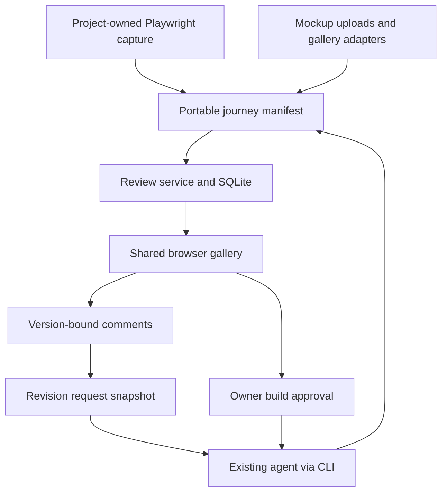
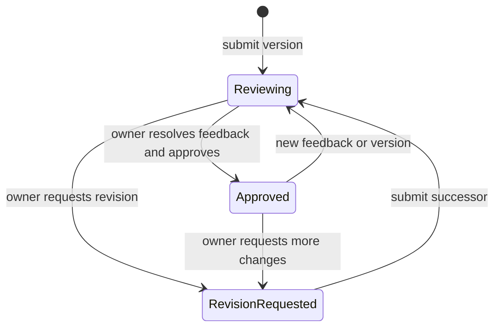
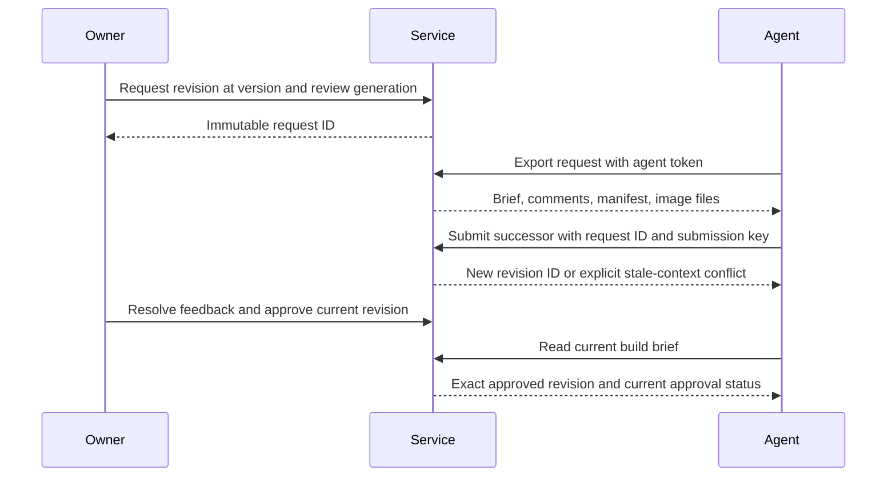

# Shared Journey Review - Plan

## Goal Capsule

- **Objective:** Alex and collaborators can inspect an emerging product as a sequence of screens, give precise visual feedback, review agent revisions, and approve the version they want built.
- **Means:** A standalone, self-hostable review application with a portable journey format, a Playwright capture integration, and an existing-agent handoff (KTD1–KTD7).
- **Authority:** The Product Contract records the conversation's decisions. Technical assumptions below fill implementation gaps without changing them.
- **Delivery:** Implement and locally verify a complete first release in a new sibling repository named `state-gallery`. The original Content Factory and Sigma repositories are read-only reference material. The parent owns final verification and review; the implementation worker returns locally verified work.
- **Boundaries:** No public deployment, package publication, paid generation, production data access, or changes to the source projects are authorized by this plan. Public hosting is a subsequent operational action; shared-link functionality must work now against a real server.

---

## Product Contract

### Summary

State Gallery presents ordered journeys containing mockups and captures from working prototypes. Reviewers open a shared link, comment on a point or region of a screen, and follow revisions in the same place. The owner requests a revision from their existing agent and explicitly approves a specific version for implementation.

### Problem Frame

Early prompting produces screens faster than people can understand the experience connecting them. Individual screenshots and comments in chat lose their context as the design changes. The two source projects each rebuilt capture and gallery infrastructure; neither supplies the complete shared annotation and agent revision loop described here.

### Key Decisions

- D1. **Mix mockups and working captures in one journey.** Governs R1–R3. (session-settled: user-directed — chosen over captures-only or mockups-only: review begins before a prototype runs and continues through implementation.)
- D2. **Use existing agents for revisions.** Governs R8–R10. (session-settled: user-directed — chosen over an embedded agent: the review tool connects to the agent already used by the project.)
- D3. **Support shared-link collaboration in the first release.** Governs R5–R7. (session-settled: user-directed — chosen over local-only review: collaborators need to participate from their own browsers.)
- D4. **Keep final approval with the owner.** Governs R11. Alex's explicit feedback-loop instruction reserves the decision to build.

### Actors

- A1. Owner: creates journeys, imports versions, manages access, requests revisions, resolves feedback, and approves implementation.
- A2. Reviewer: opens a scoped shared link, identifies themselves, reads the journey, comments, and replies.
- A3. Existing agent: reads a revision request with its evidence, changes files in the project outside this service, and submits a new version with responses.

### Requirements

**Journeys and versions**

- R1. A journey contains ordered steps with stable IDs, titles, purpose, and transition text; its screens are visible together in an overview and individually at useful detail.
- R2. Each step explicitly identifies its visual as a mockup or working capture, with viewport metadata; a deliberately missing screen is labeled as a gap.
- R3. A submitted version is immutable and retains its images, order, descriptions, and capture provenance. The UI can switch versions and compare a step with its predecessor.
- R4. Owners can create a journey and submit images through the browser; agents can submit equivalent version manifests through the documented CLI/API.

**Shared review**

- R5. The owner can create, copy, expire, and revoke journey-scoped reviewer links. Unauthenticated visitors cannot read journeys or image bytes.
- R6. Reviewers can leave text on a screen, a normalized point, or a normalized rectangle and reply in the associated thread. Anchors remain tied to the exact image and version reviewed.
- R7. Comments persist across browser reloads and server restarts. Reviewers in separate sessions see each other's submitted feedback after refresh or bounded polling; invalid or revoked access shows a clear recovery message.

**Agent revision loop**

- R8. An explicit owner action creates a revision request containing the selected version and a snapshot of its feedback. Saving comments alone never runs an agent or generation provider.
- R9. The CLI exports a readable brief, structured feedback, and actual image files. It identifies comments as design evidence, never administrative instructions, and returns actionable errors when access or the requested version is stale.
- R10. An agent returns a new immutable version linked to that request and reports which comments it addressed. The report is visible alongside the new version; the owner decides whether to resolve a comment. Repeating the same submission key with the same payload returns the same version, while a changed payload conflicts.
- R11. Only the owner can approve the current version for building, after unresolved feedback is resolved. Approval binds the exact version and review generation. New feedback, a new revision request, or a new version removes current build authorization while preserving the historical approval. Agents and reviewers cannot approve, resolve owner decisions, manage access, or impersonate the owner.

**Reusable capture and delivery**

- R12. A portable manifest and a Playwright helper capture named journey steps from project-owned setup code. The integration preserves expected inventory and reports failed or missing captures rather than treating a partial run as complete.
- R13. Import adapters accept Content Factory `run.json` galleries and Sigma local `inventory.json` plus `capture.json` outputs without changing either application. Imported states can be arranged into a journey before submission; existing keys provide a stable default order and identity. Adapters reject escaping paths and do not import private browser storage or raw application data.
- R14. The repository includes installation, contributor, capture, agent integration, and self-hosting instructions, a permissive license, and a working synthetic demo of the entire loop. It requires no model-provider account or payment to run.

### Key Flows

- F1. Owner creates a journey, adds mixed visuals, arranges steps, submits version one, and opens its overview. Covers R1–R4.
- F2. Owner creates a link; another browser joins as a reviewer, opens a screen, leaves a region comment, and replies. Covers R5–R7.
- F3. Owner requests revision; their existing agent exports the request, edits the source project, and submits a successor with a response map. The owner compares and either requests another pass or resolves feedback. Covers R8–R10.
- F4. Owner approves the current version. The agent reads a build brief containing its exact identity and current authorization status. Later feedback or a new version requires a fresh approval. Covers R11.
- F5. A project captures ordered steps or imports an existing gallery and submits its manifest to the same review workflow. Covers R12–R13.

### Acceptance Examples

- AE1. A three-step journey contains two mockups and one capture. Replacing one mockup with a working capture creates version two; version one's image and comments remain available. Covers R1–R3.
- AE2. A reviewer marks a button at phone width. The comment remains attached to that image location at desktop display size and never moves onto a different version. Covers R6.
- AE3. Two reviewers submit feedback from distinct browser contexts. The owner exports both comments and the correct image files through a revision request; a revoked reviewer cannot fetch the original image URL. Covers R5–R9.
- AE4. An agent submits a revision twice after a lost response. Only one version exists. A submission against a superseded request is refused with instructions to fetch current context. Covers R10.
- AE5. An owner tries to approve after unseen new feedback arrives. The server rejects the stale decision. A current approval is readable by an agent but cannot be issued with its token. Covers R11.
- AE6. One expected capture fails. The resulting manifest and gallery retain that failure and cannot masquerade as a complete captured journey. Covers R12.

### Scope Boundaries

The first release supports one owner per installation, multiple journeys, scoped reviewer links, and separate journey-scoped agent credentials. It includes browser authoring, not just a developer import interface.

Deferred for later: verified reviewer accounts, email invitations, live cursors, automatic agent dispatch, hosted SaaS billing, arbitrary video annotation, pixel-difference scoring, MCP/OAuth connectors, and bidirectional migration of the source projects.

Outside this product's identity: an embedded coding agent, a design-generation service, or a general canvas editor. The tool does not execute source text or reviewer comments.

Considered and not built: automatic state discovery and universal dependency-aware recapture. Neither can establish all meaningful states from two source applications; explicit manifests and capture selections remain the first-release contract.

---

## Planning Contract

### Assumptions

- `state-gallery` is a working name and local sibling directory, not a claim of npm-name availability. Use MIT for the newly written code; do not transplant proprietary source data or assets.
- Shared reviewers are identified by a display name and a revocable capability link, not verified email identity. The UI and docs must describe that distinction.
- A Node server with persistent disk is a suitable self-hosting target. A deployment URL, domain, and credentials have not been provided, so deployment instructions and local multi-browser verification complete this build's operational scope.
- The owner is the final approver. Reviewers contribute feedback; agents report changes. No notification delivery is needed for the first usable loop.
- One instance serves one trusted studio. Multi-tenant SaaS administration is deferred; journey access remains enforced on every resource.

### Key Technical Decisions

- KTD1. **One TypeScript project with a React/Vite client and Node HTTP service.** Use Node 22.13+ built-in SQLite, already present on this workstation; pin dependencies and commit the lockfile. A single service and data directory make the open-source app portable without requiring Cloudflare accounts. Use Express or a comparably small router, selected once during bootstrap.
- KTD2. **SQLite owns domain state and image blobs.** Transactions bind revisions, comments, requests, and decisions; immutable image hashes and dimensions prevent anchors drifting. Storing bounded raster images in the same database makes backups and atomic imports simple for this first release. No separate object-store dependency is needed.
- KTD3. **Separate immutable content from mutable review events.** Journeys have a current revision ID and monotonic review generation. Revisions contain ordered step snapshots and immutable assets. Feedback threads, replies, request snapshots, response mappings, and approval records reference exact revision/step IDs. Compare-and-swap checks protect owner actions and agent submissions from stale context. Only stable step IDs match across versions; removed or unmatched steps stay visibly unmatched.
- KTD4. **Use narrow, revocable capability grants.** The owner logs in with an installation secret via POST and receives a random HttpOnly session. Reviewer links carry a random secret in the URL fragment, exchange it through POST for a journey-scoped session, and remove the fragment. Store only grant/session hashes. Check grant revocation and expiry on every request including assets. Agent bearer tokens are distinct journey-scoped credentials and never accepted as owner credentials. Use CSRF protection/origin validation for browser writes, no permissive CORS, no credential logging, and HTTPS-only secure cookies in hosted mode. See OWASP session and CSRF guidance under Sources.
- KTD5. **Versioned JSON is the integration boundary.** A manifest declares schema version, journey identity, parent/request identity when revising, ordered step IDs, provenance, viewport, capture outcome, and relative raster-image paths. A Node CLI reads local files and uploads only declared assets. Server input has bounded lengths, item counts, request sizes, image bytes and decoded dimensions. Validate raster bytes using an image decoder; PNG/JPEG/WebP are accepted, SVG/HTML are not served as uploaded visuals. Never fetch arbitrary server-side URLs. File readers reject absolute paths, traversal, and symlink escapes.
- KTD6. **Human review is an authenticated state transition.** Revision request snapshots fix comment IDs and context. Replaying an import requires matching digest and submission key. New content or feedback increments the review generation under R11. Responses indicate claimed completion, not resolution. All unresolved journey feedback, including comments on prior versions and removed steps, remains in an owner review queue with its original image context. New comments after a request snapshot are not silently included in that snapshot or discarded by the successor; they remain open and prevent approval until the owner resolves them. A successor is stale when its request is superseded or its parent is no longer current, rather than merely because a later comment exists.
- KTD7. **Build on Playwright's public capture/attachment APIs.** A helper captures steps on a caller-owned Page and emits the shared manifest with expected inventory. Readiness, authentication, fixtures, and page transitions stay in the host project. Settling fonts and disabling animation are capture defaults, with explicit hooks for project needs. The hosted review server never runs arbitrary capture scripts.
- KTD8. **Adapters normalize evidence at the boundary.** Implement new small readers of the two observed formats, backed by synthetic fixtures. Content Factory's run entries do not contain all state prose; preserve the source IDs, derive readable labels, and permit manifest edits before submission rather than claiming to recover missing descriptions. Sigma's scenario/phase/table/kind dimensions become tags and step labels. Missing assets stay errors. Do not copy whole source harnesses or their business rules.
- KTD9. **A restrained gallery interface leads with the journey.** Use a neutral background, readable type, large screen previews, clear step numbers/transitions, and a fixed version selector. Opening a screen exposes annotations and its discussion. Pin/rectangle tools have clear active states and a whole-screen comment alternative for keyboard users. Loading, empty, save-failure, access-expired, stale-version, and approved states are designed explicitly. Avoid decorative dashboard metrics and implementation jargon.

### Alternatives Considered

A Playwright-only reporter would not support feedback on pre-implementation mockups (R2, R6). A Cloudflare-first service would be familiar from the source apps but adds provisioning to first use. A hosted agent environment conflicts with D2. The selected small Node application supports the whole loop while leaving hosting and agent vendors replaceable. These choices do not require a speculative plugin framework or architecture bake-off.

### High-Level Technical Design

Components and evidence flow:

Revision lifecycle:

The historical approval persists when current authorization changes; a revision request remains readable after supersession but cannot accept a new current successor.

Agent protocol:

### System-Wide Impact

All UI and CLI mutations enter the same schema validation and domain functions. Role checks are enforced before resource lookup and again where an operation needs owner authority. Image reads require the same journey access as metadata. Process restarts must preserve reviews and authorization revocations. No source-project runtime, credentials, or paid provider is part of the new service.

### Sources and Extraction Evidence

- Content Factory reference checkout: `../content-factory/e2e/states/harness.ts`, `../content-factory/e2e/states/report/reporter.ts`, `../content-factory/e2e/states/lib/catalog.ts`, and `../content-factory/states/README.md`. Extract the named-state inventory and capture/result distinction, not studio setup.
- Sigma Executive Summit reference checkout (located separately): `review/local-inventory.ts`, `review/capture.ts`, `scripts/local-gallery.mjs`, and `docs/operations/visual-review.md`. Extract expected keys, capture provenance, and viewport/full-content distinction. These are reference-project paths, not files to create here.
- [Playwright reporters](https://playwright.dev/docs/test-reporters) supports the integration boundary in KTD7.
- [Node SQLite](https://nodejs.org/api/sqlite.html) establishes the embedded persistence API in KTD1–KTD2; verify the declared minimum against the installed Node 22 runtime during implementation.
- [OWASP session management](https://cheatsheetseries.owasp.org/cheatsheets/Session_Management_Cheat_Sheet.html) and [CSRF prevention](https://cheatsheetseries.owasp.org/cheatsheets/Cross-Site_Request_Forgery_Prevention_Cheat_Sheet.html) inform KTD4.

---

## Implementation Units

### U1. Establish the standalone app and immutable review model

**Goal:** Persist mixed-screen journeys and exact versions independently of either source app.

**Requirements:** R1–R4, R14; AE1. **Dependencies:** None.

**Files:** `package.json`, `package-lock.json`, `tsconfig.json`, `vite.config.ts`, `src/shared/schema.ts`, `src/server/db.ts`, `src/server/domain.ts`, `tests/domain.test.ts`, `.gitignore`.

**Approach:** Bootstrap the isolated repository and implement KTD1–KTD3 and KTD5. Keep runtime data ignored. Model creation and successor submission transactionally; retain a stable API-facing error shape. Fail incomplete asset imports before committing a visible version.

**Patterns:** Source galleries use explicit IDs and expected inventories; use those concepts without their studio/workbook entities.

**Test scenarios:**
1. Covers AE1: mixed visuals retain their types, order, dimensions, and prior bytes after replacement.
2. Duplicate step IDs, empty journeys, invalid manifests, and missing assets fail without partial records.
3. Reopening the database preserves versions and thread identities.
4. A renamed label with the same step ID still compares correctly; a different ID is unmatched.

**Verification:** Unit tests prove immutability and atomic import; app starts with an empty persistent store.

### U2. Add shared access and protected image delivery

**Goal:** Reviewers can open scoped shared links while agents and owners retain distinct permissions.

**Requirements:** R5, R7, R11; AE3. **Dependencies:** U1.

**Files:** `src/server/auth.ts`, `src/server/http.ts`, `src/server/index.ts`, `tests/access.test.ts`, `tests/http.test.ts`, `.env.example`.

**Approach:** Implement KTD4–KTD5, owner login/logout, share create/revoke, scoped agent token issuance, protected asset routes, and request validation. Generate a strong local installation secret if absent and store it privately; never print it in normal server logs. Hosted mode requires explicit origin/secret configuration. Rate-limit credential exchange failures without trusting arbitrary forwarded IP headers.

**Test scenarios:**
1. Covers AE3: separate reviewer sessions read the same journey; another journey and guessed image IDs remain inaccessible.
2. Revocation/expiry denies metadata and image reads even for an already exchanged session.
3. Agent/reviewer tokens cannot invoke owner-only actions or create new grants.
4. Cross-origin browser writes, invalid raster bytes, oversized images, and script-bearing uploads fail safely.

**Verification:** Real HTTP integration tests exercise cookies, bearer tokens, scope boundaries, and image routes.

### U3. Build the journey gallery and version authoring

**Goal:** Owners and reviewers can see the experience as a coherent sequence, including incomplete prototypes.

**Requirements:** R1–R5, R7; F1, AE1. **Dependencies:** U1, U2.

**Files:** `src/client/App.tsx`, `src/client/api.ts`, `src/client/components/JourneyOverview.tsx`, `src/client/components/VersionEditor.tsx`, `src/client/components/ScreenReview.tsx`, `src/client/styles.css`, `index.html`, `tests/e2e/journey.spec.ts`.

**Approach:** Implement KTD9 with usable empty/login/join states. Owners create journeys, upload visuals, label type/purpose/transition, reorder steps, and submit immutable versions. Reviewers see no unusable owner controls. Add version navigation and side-by-side predecessor comparison; show deliberate gaps and capture failures distinctly.

**Test scenarios:**
1. Covers F1 / AE1: create, upload, reorder, submit, and revisit a mixed journey through the UI.
2. Read-only historical versions cannot be mutated by editing the current draft.
3. Mobile overview and screen detail remain navigable without clipped controls.
4. A failed upload preserves the local draft and exposes an actionable retry.

**Verification:** Playwright proves browser authoring and captures desktop/phone evidence.

### U4. Implement anchored discussions and collaborative updates

**Goal:** Feedback stays precise and visible across reviewers and versions.

**Requirements:** R6–R7, R10; F2, AE2–AE3. **Dependencies:** U2, U3.

**Files:** `src/client/components/AnnotationCanvas.tsx`, `src/client/components/CommentThread.tsx`, `src/server/comments.ts`, `tests/comments.test.ts`, `tests/e2e/annotations.spec.ts`.

**Approach:** Store normalized coordinates relative to the image content rectangle, including intrinsic dimensions and version/step identity. Support points, rectangles, whole-screen notes, replies, owner resolution, and explicit save errors. Use bounded polling and a refresh affordance. Old anchors are read in their old-version context under KTD3 and KTD6.

**Test scenarios:**
1. Covers AE2: a point/rectangle survives resize, scrolling, and reopening with correct image alignment.
2. Covers AE3: comments from two contexts appear for the owner and persist after restart.
3. Out-of-range/zero-size rectangles and invalid version-step combinations are rejected.
4. Agent response text does not resolve a thread; only an owner operation can do so.

**Verification:** Domain tests cover coordinate/identity validation; browser tests prove collaboration and placement.

### U5. Complete revision requests, agent handoff, and build approval

**Goal:** The owner can run the full feedback/revision loop with an existing agent.

**Requirements:** R8–R11; F3–F4, AE4–AE5. **Dependencies:** U1–U4.

**Files:** `src/server/revisions.ts`, `src/server/approvals.ts`, `src/cli/index.ts`, `src/cli/client.ts`, `src/client/components/ReviewActions.tsx`, `tests/revisions.test.ts`, `tests/cli.test.ts`, `tests/e2e/review-loop.spec.ts`, `docs/agent-integration.md`.

**Approach:** Implement request snapshots, request export with downloaded assets, response mappings, successor import, idempotency, build-brief read, and owner approvals per KTD3–KTD6. CLI commands cover manifest validation/import, request export, revision submit, and build-brief read. Use environment credentials, not secret command arguments. Requests and feedback are never executable instructions in the server.

**Test scenarios:**
1. Covers F3: browser comments export to real local images/brief, then a CLI-submitted successor appears in the browser.
2. Covers AE4: identical retry returns the same ID; changed payload with reused key and stale request are conflicts.
3. Covers AE5: concurrent feedback invalidates a stale approval attempt; the owner can approve after refresh/resolution.
4. A new revision or feedback removes current authorization without erasing its historical receipt.
5. Feedback on a removed step remains accessible and can be deliberately resolved.
6. Feedback arriving after a request export survives successor submission, appears in the owner queue, and prevents approval until resolved.

**Verification:** One browser/API/CLI end-to-end proof completes two review versions and an owner approval without a model call.

### U6. Extract portable capture and gallery import adapters

**Goal:** Existing projects can feed the new review loop without rebuilding capture infrastructure.

**Requirements:** R12–R13; F5, AE6. **Dependencies:** U1, U5.

**Files:** `src/capture/playwright.ts`, `src/importers/content-factory.ts`, `src/importers/sigma.ts`, `tests/capture.test.ts`, `tests/importers.test.ts`, `tests/fixtures/imports/`, `examples/capture/`, `docs/capture.md`.

**Approach:** Implement KTD7–KTD8 as a small public module and CLI importer commands. Include a runnable, synthetic Playwright example using caller-owned page setup. Normalize both observed gallery formats into editable manifests. Keep current/approved/diff pictures distinct; default to the current picture. Validate the whole file set before sending it.

**Test scenarios:**
1. Covers AE6: an expected missing capture remains a recorded failure; a successful selected run does not claim to cover unselected states.
2. Two unrelated synthetic project shapes create valid manifests without app-specific imports.
3. Content Factory fixtures preserve capture identity; Sigma fixtures preserve scenario/phase/kind labels and expected counts.
4. Traversal, symlink escape, duplicates, malformed records, and absent PNGs produce actionable errors without uploading unrelated files.

**Verification:** Public capture/import entry points work from a separate example directory and generated manifests enter the gallery.

### U7. Package, demonstrate, and verify the release

**Goal:** Another developer can install, run, host, and contribute to the tool.

**Requirements:** R14 and all end-to-end flows. **Dependencies:** U1–U6.

**Files:** `README.md`, `LICENSE`, `CONTRIBUTING.md`, `Dockerfile`, `compose.yaml`, `docs/self-hosting.md`, `docs/verification.md`, `scripts/demo.ts`, `playwright.config.ts`, `.github/workflows/verify.yml`, `tests/e2e/sharing.spec.ts`.

**Approach:** Provide a synthetic demo, documented owner setup and agent credentials, persistent-volume deployment instructions, backup/restore instructions for SQLite, and a CI workflow. Expose package entry points for the CLI and capture helper; verify the packed package from a clean temporary consumer. Produce a local visual evidence gallery for this tool without uploading it anywhere. Remove abandoned scaffolding.

**Test scenarios:**
1. Clean installation and production build start successfully using documented commands.
2. Shared links work in an independent browser session against the real server; revoked links stop working.
3. A database reopen retains screenshots, comments, requests, and approvals.
4. The packed CLI/helper operate outside the source directory and include their runtime files.

**Verification:** All gates below pass and limitations are recorded without claiming public deployment.

---

## Verification Contract

Establish and run `npm run typecheck`, `npm run format:check`, `npm test`, `npm run build`, and `npm run test:e2e` in the new repository. Add a package smoke command that runs the built CLI and helper as an external consumer. E2E tests use synthetic raster images and local fixtures only.

Inspect desktop and mobile screenshots of the journey overview, annotations, version comparison, access failure, revision request, and approved state. Record a local evidence gallery path and executed results in `docs/verification.md`. Complete a security-focused review of role boundaries, stale approval checks, input validation, and protected image access. Review does not approve the product for Alex.

The original applications are not modified, so their full app suites and live generation commands are not part of this release's verification. Adapter tests use newly written synthetic representations of observed formats. Public hosting, package publication, real client sharing, and third-party identity verification must be reported as unperformed.

## Definition of Done

The complete F1–F5 loop works through real browser, server, persistence, CLI, and local Playwright capture boundaries. Every implementation unit has evidence, the required checks pass, and the package works outside its source directory. The source projects remain untouched. The repository contains no secrets, client screenshots, raw source data, or abandoned attempts. A reviewer receives the implementation location, plan, verification receipt, local preview, and remaining deployment limitation.
