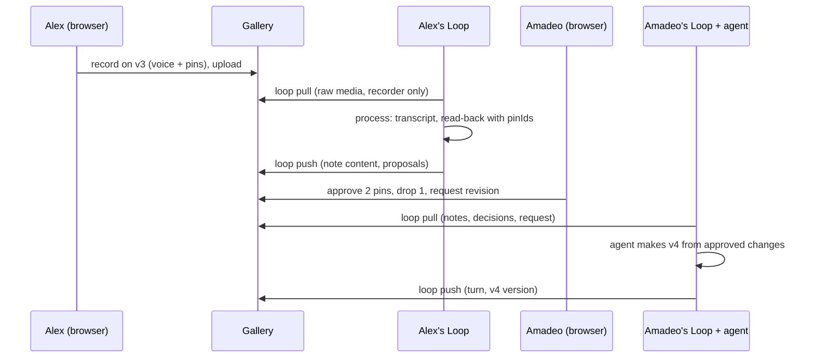
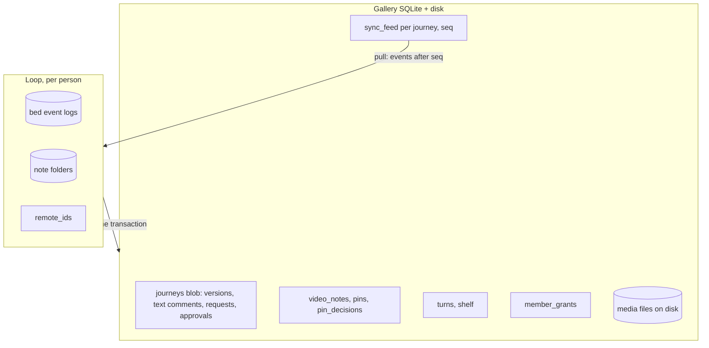

# Loop video notes in the shared gallery - Plan

**Target repos:** this repo (State Gallery, `AlexDistill/state-gallery`) for the gallery side, and Loop (`AlexDistill/loop`) for the sync side. Paths below are prefixed `gallery:` or `loop:` and are relative to each repo's root.

Plan 3 of 3 for the Loop first slice. Origin design: `loop:docs/design.md` (sections 6, 7, 10, 11). Builds on the Loop core plan, `loop:docs/plans/2026-10-26-loop-core.md`, now in `AlexDistill/loop` PR 1.

---

## Goal Capsule

- **Objective:** two people working on a shared project can talk through a version in the gallery, see each spoken point as a pin with a proposed change, decide each change, and have the next version made from those decisions, while each person's local Loop stays in step with the gallery the way a clone stays in step with a remote.
- **Means:** video notes become a new gallery comment kind with per-pin decisions, stored outside the journey blob alongside a turns-and-shelf record and an ordered change feed; Loop gains person-run `link`, `pull`, `push` and `status` commands that sync a `shared:` bed with the gallery (KTD1, KTD3).
- **Authority:** the Product Contract wins on behavior; KTDs win on mechanism within their Rs; the Loop core plan's settled decisions still hold.
- **Stop conditions:** stop and ask Alex if a requirement can't be met without sending a confidential or unshared note to the gallery (R9), letting a pin decision be recorded without a verified person (R6), or making the gallery run a model (R12).
- **Execution profile:** test-first per unit. Gallery units (U1 to U7) land on a branch of this repo; Loop units (U8 to U12) land on a branch of Loop. U13 is the two-person end-to-end check.
- **Who finishes:** an implementing agent builds U1 to U12; Alex and Amadeo run U13.

---

## Product Contract

### Summary

The gallery gets a record button on every version. A person talks and clicks; each click drops a pin on the version image, and the recording uploads to the shared project unprocessed. The recorder's own Loop pulls it, transcribes it and reads it back, then pushes a proposed change for each pin. Any member can approve, change or drop each proposal in the gallery, then request a revision; the agent working that seed pulls the decisions and makes the next version. The gallery also shows a seed's history of turns and its shelf.

### Problem Frame

Today the gallery only has text pins, and Loop's spoken, pointed notes live on one machine. Alex and Amadeo can't both react to the same version in the same place, and an agent can't see what the other person decided. The design calls for the gallery to be the shared remote and each person's Loop the local clone.

### Requirements

**Recording and pins**
- R1. A member can record a video note on any version step in the gallery: voice plus the pointer track over the image by default, with screen capture as an option.
- R2. Each click while recording drops a pin on the version image at a point or region anchor in the gallery's existing anchor model, with its time in the recording.
- R3. The recorder watches the recording back before it uploads, and can discard it.
- R4. Before recording, the gallery says plainly that recordings go to the shared project; recording is unavailable on a seed marked confidential.

**Proposals and decisions**
- R5. After processing, each pin shows its proposed change, quoted from what was said; a change with no pin gets a pin at the pointer position at that moment.
- R6. A member decides each proposal: approve, change (approve with edited text) or drop. Each decision records which member made it, verified by their member identity, and when.
- R7. The first decision to reach the gallery wins; a later conflicting decision is refused with the existing one shown, and both remain in history.
- R8. A member can request a revision from a version; the request contains that version's decided pins, dropped pins resolve, and undecided pins stay open without blocking.

**Sync**
- R9. Only notes that are shared with agents and not confidential are pushed; pushing a note sends its folder content (video, transcript, read-back, frames, pins, changes). Moving a note out of the shared bed, or marking it or its seed confidential, retracts it from the gallery and from other members' Loops at their next pull.
- R10. `loop pull` brings a linked journey's notes, decisions, versions, turns and shelf into the person's `shared:` bed; pulled notes arrive shared with agents.
- R11. Only the recorder's Loop receives a gallery recording's raw media for processing; other members' Loops get the note once it has been processed.
- R12. The gallery runs no model; transcription and read-backs happen in the recorder's Loop.
- R13. Push and pull are safe to repeat: a retried push creates nothing twice, and a pull applies each gallery event once.
- R14. Push is a person-only command; agents can see sync state but cannot push.

**Turns, versions and the shelf**
- R15. A turn whose outputs include images becomes the next gallery version of its seed's journey; its other outputs are listed on the turn but not shown as steps.
- R16. When two members push a next version from the same parent, the first becomes the version and the second is kept as a turn marked as not a version, with a message to pull and redo.
- R17. The gallery shows a seed's turns in order, with what went in, what came out and the reaction notes, plus its shelf with reasons; read-only.

**Agents**
- R18. After a pull, an agent sees through Loop MCP each note's pins, proposals, decisions with who made them, pending revision requests and what is waiting to sync.
- R19. A chat approval of a change on a shared-bed note counts as the one confirmation locally but shows as pending sync until the gallery accepts it; an agent does not build on a pending decision.

### Key Decisions

- **The gallery is the shared remote; Loop is the clone; only `shared:` beds sync.** (session-settled: user-directed — chosen over a local-only gallery: the team works on the same thing.) Governs R9, R10, R13.
- **Saying yes counts as the one confirmation, in chat or in the gallery.** (session-settled: user-directed — chosen over approval only in specific apps.) Governs R6, R19.
- **Confidential recordings stay local.** (session-settled: user-approved — chosen over sending every recording.) Governs R4, R9.
- **The gallery stays model-free; the recorder's Loop processes gallery recordings.** (session-settled: user-approved — chosen over processing on the gallery server.) Governs R11, R12.
- **Sync is person-run, not background.** (session-settled: user-approved — chosen over automatic sync: nothing leaves a machine unless a person sends it.) Governs R14.

### Success Criteria

- Alex records a note on a version in the gallery, runs `loop pull`, and within one pull-process-push cycle the pins show proposals in the gallery.
- Amadeo, on his own machine, approves two pins and drops one in the gallery and requests a revision; Alex's agent, after `loop pull`, makes the next version from exactly the two approved changes, and `loop push` shows it as the next version.
- Running `loop push` twice in a row changes nothing the second time.

### Scope Boundaries

**Deferred to follow-up work**
- Margin (plan 2) recording straight into the gallery; Margin notes reach the gallery through `loop push` like any other note.
- Opening `loop pull` to agents (it is the safest first sync step to open later).
- Restricting the keychain item's access to the `loop` binary only.
- Slack thread delivery; Figma and Flora versions.

**Accepted for v0, with reasons**
- The member token sits in the macOS keychain, readable by any process running as the user; an agent with a shell could read it. The TTY gate on push and the README's Claude Code deny rules are the guard; a binary-scoped keychain ACL is deferred.
- Undecided proposals on a note may be re-worded by a later reprocess of that note; decided ones never change.
- A first link pushes all existing shared, non-confidential history of the seed (no partial backfill), but only after the person has seen the list and confirmed it at the terminal (U11).
- Copies already acted on can't be recalled: a retraction removes the note from the gallery, open request snapshots and other members' Loops, but not from a brief an agent already exported or a version already built from it.
- A member token held by an agent with a shell can call the gallery API directly; push being person-only is enforced by Loop's terminal gate and deny rules, not by the gallery.
- If a recorder never pulls, their unprocessed note waits; the owner can discard it from the gallery.

---

## Planning Contract

### Key Technical Decisions

- KTD1. **New gallery tables, not the journey blob.** Video notes, pins, pin decisions, turns, shelf rows, member grants and a per-journey sync feed live in their own SQLite tables keyed by journey id. Only versions, text comments, requests and approvals stay in the blob. The client re-fetches the whole journey every few seconds and every blob write bumps `generation` and clears approvals, so notes and processing results must not churn it. Writes that bump `generation`: new versions, new text comments, pin decisions and revision requests; only blob writes (versions, text comments, requests) clear version approvals, and pin decisions don't. The journey poll also returns the journey's latest feed seq, and the client re-fetches notes and pins when it changes.
- KTD2. **The pin is the stable key.** A gallery pin has an id minted in the browser; each Loop change carries `pinId`. The read-back receives the pin list and returns `pinId` (or null) per change; reprocessing updates the proposal text on undecided pins and never touches decided ones. Serves R5, R13 and the accepted-for-v0 line on rewording.
- KTD3. **One push is one server transaction in a fixed order; binary content goes first.**
  - Recordings, frames and version images are uploaded beforehand through the U2 raw route, keyed by journey and sha256, so a repeat upload returns the existing id.
  - The push JSON refers to them by id only and stays under the 40 MB body limit; a large backfill is split into several pushes applied in event order.
  - Order inside a push: link state (the seed's confidential flag), notes and processing results, decisions, turns and versions, shelf rows, retractions. Revision requests are made in the gallery and only travel to Loop on pull.
  - Each item carries its Loop event id; the server records applied ids and skips repeats; a push naming missing media is refused; any failure rolls back the whole push. Uploads no committed note references are deleted after a day.
  - Identity comes from the authenticated member token: the decider of each decision, the recorder of each note and the author of each turn and version are set by the server, and identity fields in the payload are ignored.
  - Serves R6, R13.
- KTD4. **Per-journey sync feed.** Every gallery write that a Loop needs appends `{seq, kind, ids}` to the journey's feed; note events carry the note id and a content version, not the content, so pull fetches the current content and a retracted note returns a tombstone. `loop pull` asks for events after its last seq. Raw media for an unprocessed note is listed only in the recorder's feed view (R11).
- KTD5. **Member role with per-person identity.** The owner invites a person to a journey; the invite yields both a member token (for Loop) and a browser session bound to the same member id. Members can comment, record, decide pins, request revisions and push. The owner keeps installation admin, version approval, setting a link's confidential flag, and discarding a stranded unprocessed note. Display names come from the grant, not free text. Invites expire 7 days after creation if unredeemed; the member token also signs the member back into a new browser session, so a lost cookie or a second device keeps the same member id. Existing reviewer and agent roles are unchanged. Serves R6, R14.
- KTD6. **Video on disk with Range serving.** Uploads stream to files under the data directory (raw PUT before the JSON middleware), `audio/webm`, `audio/mp4`, `video/webm`, `video/mp4` and the image types already accepted, capped at 500 MB; metadata in SQLite; playback through Range responses; the security policy gains `media-src 'self' blob:` so the pre-upload preview plays. Browsers record WebM (Chromium, Firefox) or MP4 (Safari). On pull, Loop converts a voice-and-pointer recording to `audio.m4a` with medium `audio`, and a screen-capture recording to `recording.mp4` with medium `video`. The self-hosting docs give the media route a 500 MB proxy limit.
- KTD7. **Recording is voice plus pointer by default.** `MediaRecorder` with a probed mime type, pointer positions normalized against the rendered image box (accounting for letterboxing) and timed from recorder start; `getDisplayMedia` is an opt-in extra.
- KTD8. **Decisions are compare-and-set per pin, not per journey.** A decision names the pin's current state; a mismatch is refused with the current decision. A chat approval travels in the next push and is accepted only if the pin is still undecided. Loop's store gains one gallery-decision transition that applies a pulled decision (approved, changed with its final text, or dropped) to a proposed or pending change, records the deciding member and time from the feed, and keeps any superseded local decision in history. Serves R6, R7, R19.
- KTD9. **Loop talks to the gallery through a small client inside Loop**, using the documented HTTP API with the member token, rather than depending on the gallery package. Keeps the repos decoupled.
- KTD10. **A seed links to one journey; versions take the first parent.** `loop link` binds a seed in a `shared:` bed to a journey and records the mapping in Loop's new `remote_ids` table (deferred from the core plan). A turn's first parent maps to the version `parentId`. Linking (or a member's first pull) also marks that member's grant as having a linked Loop; the Record control shows only for members with a linked Loop, since only the recorder's Loop can process their recording.
- KTD11. **Retraction is a tombstone.** Moving a pushed note out of the shared bed, or marking it or its seed confidential, sends a retraction in the next push. Only the note's recorder or the owner may retract it; any other member's retraction fails the push. The gallery deletes the note's media and pins, redacts its pin text and transcript excerpts from open request snapshots, and appends a feed event; other Loops delete their copy on pull, but only for notes `remote_ids` maps to the linked shared bed.

### High-Level Technical Design

**One cycle, from recording to the next version**

**Where data lives**

### Implementation Constraints

- Gallery: keep its existing test runner (`node:test` via tsx), Express 5, zod 4.1.5, React 19; Playwright e2e gains Chromium fake media flags for recording tests.
- Loop: keep its Global Constraints from the core plan, including bed rules, consent gates and person-only TTY commands.
- No model or transcription runs in the gallery.

---

## Implementation Units

| U-ID | Title | Main files | Depends on |
|---|---|---|---|
| U1 | Member grants and verified identity | `gallery:src/server/domain.ts`, `gallery:src/server/http.ts` | — |
| U2 | Video media on disk | `gallery:src/server/media.ts`, `gallery:src/server/http.ts` | U1 |
| U3 | Notes, pins, decisions, turns, shelf and the feed | `gallery:src/server/notes.ts`, `gallery:src/shared/schema.ts` | U1 |
| U4 | Sync API: feed, push, link, retract | `gallery:src/server/sync.ts` | U2, U3 |
| U5 | Recording on a version | `gallery:src/client/Recorder.tsx`, `gallery:src/client/App.tsx` | U2, U3 |
| U6 | Pin decisions and revision requests in the gallery | `gallery:src/client/PinDecisions.tsx`, `gallery:src/cli/client.ts` | U3, U5 |
| U7 | Turns and shelf view | `gallery:src/client/Turns.tsx` | U3 |
| U8 | Loop: pin-keyed changes, overrides, pending sync, remote ids | `loop:src/store/*` | — |
| U9 | Loop: read-back with pins | `loop:src/engine/*` | U8 |
| U10 | Loop: gallery client and link | `loop:src/sync/client.ts`, `loop:src/cli/index.ts` | U4, U8 |
| U11 | Loop: pull and push | `loop:src/sync/pull.ts`, `loop:src/sync/push.ts` | U9, U10 |
| U12 | Loop: agent surface for sync | `loop:src/mcp/tools.ts`, `loop:src/lenses/left-off.ts` | U11 |
| U13 | Two-person end-to-end check | `loop:docs/2026-10-26-gallery-run.md` | U6, U7, U12 |

### U1. Member grants and verified identity

- **Goal:** each person in a shared project has a member identity used by both their Loop and their browser.
- **Requirements:** R6, R14; KTD5.
- **Files:** `gallery:src/server/domain.ts`, `gallery:src/server/http.ts`, `gallery:src/shared/model.ts`, `gallery:src/cli/index.ts`; tests `gallery:tests/members.test.ts`.
- **Approach:**
  - A `member_grants` table: id, journey id, display name, token hash, created, revoked.
  - The owner creates an invite (CLI `invite` and an owner-only route); it expires after 7 days unless redeemed, and the owner can revoke a pending one.
  - Redeeming it in the browser sets a browser session bound to the member id and shows the member token once, for `loop link`.
  - A member sign-in route turns the member token into a new browser session for the same member id.
  - Member sessions may comment, record, decide pins, request revisions and push; owner-only actions stay owner-only.
- **Patterns to follow:** the existing `auth` table and journey-scoped agent tokens in `domain.ts`; owner checks in `http.ts`.
- **Test scenarios:**
  - An invite redeemed twice fails the second time.
  - A member session's comment author is the grant's display name, not a typed name.
  - A member can request a revision; a reviewer still cannot.
  - A revoked member token is refused on every route.
  - A member token for journey A is refused on journey B.
  - An invite older than 7 days is refused.
  - After logout, the member token opens a new browser session under the same member name.
- **Verification:** gallery tests pass; the owner can invite Amadeo and both his browser and his Loop act as "Amadeo".

### U2. Video media on disk

- **Goal:** recordings upload, are stored as files and play back with seeking.
- **Requirements:** R1, R3, R11; KTD6.
- **Files:** `gallery:src/server/media.ts`, `gallery:src/server/http.ts`, `gallery:docs/self-hosting.md`; tests `gallery:tests/media.test.ts`.
- **Approach:**
  - A raw-upload route mounted before the JSON-only middleware, streaming to a temp file and renaming on completion.
  - Accept the KTD6 types up to 500 MB; key each file by journey and sha256 so a repeat upload returns the existing id; store path, mime, size and sha256 in SQLite.
  - Serve with Range support; add `media-src 'self' blob:` to the security policy.
  - Access rule: raw media of an unprocessed note is readable only by its recorder member (R11); processed media by any member of the journey.
  - Remove uploads no committed note references after a day.
- **Test scenarios:**
  - A 2 MB webm upload is stored and its sha256 recorded.
  - A Range request for bytes 0-99 returns 206 with 100 bytes.
  - A `text/plain` mime or a 501 MB body is refused with a plain message; `audio/webm` is accepted.
  - Uploading the same bytes twice returns the same id and stores one file.
  - Another member's token and the owner's can't fetch an unprocessed note's raw media; the recorder's can.
- **Verification:** a recorded clip plays and seeks in Chromium and Safari against a local gallery.

### U3. Notes, pins, decisions, turns, shelf and the feed

- **Goal:** the new records exist outside the journey blob, with an ordered per-journey feed.
- **Requirements:** R2, R5, R6, R7, R8, R15, R16, R17; KTD1, KTD2, KTD4, KTD8.
- **Files:** `gallery:src/server/notes.ts`, `gallery:src/server/domain.ts`, `gallery:src/shared/schema.ts`, `gallery:src/shared/model.ts`; tests `gallery:tests/notes.test.ts`.
- **Approach:**
  - Tables: `video_notes` (journey, version, step, recorder member, media id, status unprocessed/processed/retracted, transcript, summary), `pins` (id from the browser, note, anchor, atMs), `pin_proposals` (pin, quote, proposal), `pin_decisions` (pin, status approved/changed/dropped, text, member, at, superseded flag), `turns`, `shelf`, `sync_feed` (journey, seq, kind, payload), `applied_events` (Loop event id).
  - Decision is compare-and-set on the pin's current decision id (KTD8); a refusal returns the current decision.
  - A revision request from a member on the current version includes approved and changed pins from every version of the journey that no earlier request has consumed, the same way it already carries unresolved text comments across versions; dropped pins resolve; undecided stay (R8). This extends the existing request snapshot to read pin decisions.
  - Only decisions, requests, versions and text comments bump `generation` (KTD1).
- **Patterns to follow:** `Store.mutate` transactions and `BEGIN IMMEDIATE` in `domain.ts`; anchor schema in `schema.ts`.
- **Test scenarios:**
  - Creating a note with three pins appends one feed event carrying the note id and content version, not the pin text.
  - Pins decided on v3 after v4 exists appear in a request made from v4.
  - A pin decision bumps `generation` but leaves the owner's version approval in place.
  - Two decisions on the same pin from the same prior state: the first wins, the second is refused with the first returned, and both rows exist (one superseded=false).
  - "Changed" stores the edited text and counts as approved in the request.
  - A request from v3 with two approved, one dropped and one undecided pin contains two items; the dropped pin is resolved; the undecided stays open.
  - Saving processing results doesn't change `generation`; a decision does.
- **Verification:** gallery tests pass; the journey blob size doesn't grow with notes.

### U4. Sync API: feed, push, link, retract

- **Goal:** Loop can read what changed and send its changes in one safe call.
- **Requirements:** R9, R10, R11, R13, R15, R16; KTD3, KTD4, KTD10, KTD11.
- **Files:** `gallery:src/server/sync.ts`, `gallery:src/server/http.ts`, `gallery:docs/agent-integration.md`; tests `gallery:tests/sync.test.ts`.
- **Approach:**
  - `GET` feed after a seq for a journey, filtered per member (raw media rows only for the recorder).
  - `POST` push: one transaction in the KTD3 order; identities set from the token (KTD3); skip event ids already applied; refuse a push naming missing media; roll back on any failure.
  - Pushed folder files are accepted only under a fixed set of names (recording, audio, transcript, read-back, frames/<n>.png or .jpg, pins) and stored under server-minted ids.
  - A turn that answers a revision request carries the gallery request id; the version records it as `requestId` with `responses` keyed by the request's pin items, so the request's successor is set.
  - A pushed decision on a pin is checked against that pin's current decision, never against the journey generation.
  - A turn with image outputs becomes a version only if its first parent maps to the journey's current version; otherwise it is stored as a turn marked not-a-version with a reason (R16).
  - Link: bind a journey to a Loop seed id and bed; each push carries the seed's current confidential state and the gallery sets the link flag from it before anything else; while it is set, recording uploads are refused (R4). Only the owner can clear it from the gallery.
  - Retract: per KTD11, recorder or owner only.
- **Test scenarios:**
  - Pushing the same payload twice: the second applies nothing and returns the same result.
  - A push whose third item fails leaves nothing from the first two.
  - Two pushes of a v4 from v3: the first becomes the version; the second becomes a not-a-version turn with the reason.
  - Feed for a non-recorder member omits the raw media of an unprocessed note.
  - A retraction removes media from disk and pulls of other members see a retracted event.
  - A push from an agent token is refused (R14).
  - A push from Amadeo's token whose decision names Alex is stored as decided by Amadeo.
  - A retraction of Alex's note pushed with Amadeo's token is refused and the note, media and pins remain.
  - A pushed folder file named `../x` is refused.
  - A push with one decision and one request-answering version on the same version succeeds, and the request's successor is set.
  - A member linking after a retraction pulls no content from the retracted note.
- **Verification:** gallery tests pass; `docs/agent-integration.md` documents the sync routes.

### U5. Recording on a version

- **Goal:** a member records a video note with pins on a version.
- **Requirements:** R1, R2, R3, R4; KTD7.
- **Files:** `gallery:src/client/Recorder.tsx`, `gallery:src/client/App.tsx`, `gallery:src/client/api.ts`, `gallery:src/client/styles.css`; tests `gallery:tests/e2e/recording.spec.ts`.
- **Approach:**
  1. A Record control in the screen review, shown only to members with a linked Loop and hidden when the link is confidential, with the line "Recordings here go to the shared project"; members without a linked Loop see "Link Loop to record notes here".
  2. On start: mic prompt, `MediaRecorder` with a probed mime, optional screen capture.
  3. While recording: pointer track normalized to the image box; each click drops a numbered pin using the existing marker component, with `atMs`; drag makes a region pin.
  4. On stop: a preview with the pins on a timeline; Upload or Discard.
- **Patterns to follow:** the `ScreenReview` component and its `Marker` pins in `App.tsx`.
- **Test scenarios:**
  - With Chromium fake media, recording 3 seconds of voice and clicking twice uploads one note with an audio mime and two pins whose anchors are within the image (0 to 1).
  - A member with no linked Loop sees no Record control.
  - Discard uploads nothing.
  - On a confidential link the Record control is absent.
  - A letterboxed image maps a click at the image's top-left corner to (0, 0).
- **Verification:** the e2e test passes; recording works by hand in Chromium and Safari.

### U6. Pin decisions and revision requests in the gallery

- **Goal:** members see proposals on pins, decide them and request a revision; agents get them in the exported brief.
- **Requirements:** R5, R6, R7, R8; KTD8.
- **Files:** `gallery:src/client/PinDecisions.tsx`, `gallery:src/client/App.tsx`, `gallery:src/cli/client.ts`; tests `gallery:tests/pin-decisions.test.ts`, `gallery:tests/e2e/pin-decisions.spec.ts`.
- **Approach:**
  - Each pin opens its quote, proposal, Approve / Change / Drop, and decision history with member names.
  - An unprocessed note shows "Waiting for <recorder>'s Loop to process this".
  - A refused decision shows "Amadeo already approved this at 14:02".
  - "Request revision" is available to members; the exported `brief.md` and `feedback.json` list approved and changed pins with their final text, the version step, anchor and the note's transcript excerpt around `atMs`.
- **Test scenarios:**
  - Approving, editing and dropping three pins shows three decisions with the member's name.
  - A stale decision attempt shows the existing decision and changes nothing.
  - The exported brief for a request lists only decided pins with final text.
- **Verification:** tests pass; Amadeo can decide pins on Alex's note in his own browser.

### U7. Turns and shelf view

- **Goal:** a read-only history of a seed's turns and its shelf in the gallery.
- **Requirements:** R15, R16, R17.
- **Files:** `gallery:src/client/Turns.tsx`, `gallery:src/client/App.tsx`, `gallery:src/server/http.ts`; tests `gallery:tests/turns-view.test.ts`.
- **Approach:** a route returning turns in order with inputs, outputs (non-image outputs listed by title), reaction notes and the not-a-version marker; a shelf list with reasons; a tab beside the journey.
- **Test scenarios:**
  - Three pushed turns render in order with their outputs, and a video output appears as a listed item, not a step.
  - A not-a-version turn shows its reason.
  - The shelf lists items with reasons, newest first.
- **Verification:** tests pass.

### U8. Loop: pin-keyed changes, overrides, pending sync, remote ids

- **Goal:** Loop's store can hold gallery identities and decisions without breaking its once-only approvals.
- **Requirements:** R7, R13, R19; KTD2, KTD8, KTD10.
- **Files:** `loop:src/types.ts`, `loop:src/store/store.ts`, `loop:src/store/history.ts`, `loop:src/store/db.ts`; tests `loop:tests/store-sync.test.ts`.
- **Approach:**
  - `Change` gains `pinId` and a `syncState` (local, pending, accepted). `setChanges` keys by `pinId` when present: undecided proposals are updated in place, decided ones untouched.
  - A changed decision is stored as approved with a `finalProposal`; `read_note`, `left_off` and briefs use the final text.
  - A new gallery-decision transition (KTD8) applies a pulled decision to a proposed or pending change, emitting an event and keeping any superseded local decision in history.
  - A chat approval on a shared-bed note is stored with `syncState: pending`.
  - A `remote_ids` table maps Loop ids to gallery ids, plus a per-journey last-pulled seq.
- **Test scenarios:**
  - Reprocessing with reworded proposals keeps pin ids and decided changes unchanged.
  - A gallery drop overriding a pending local approval leaves the change dropped, with the local approval in history.
  - A pulled "changed" decision on a proposed change shows the edited text to the agent, with the deciding member's name.
  - A chat approval on a personal-bed note is accepted immediately; on a shared-bed note it is pending.
  - Rebuild from events reproduces `pinId`, `syncState` and remote ids.
- **Verification:** Loop tests pass.

### U9. Loop: read-back with pins

- **Goal:** the read-back ties each change to a pin.
- **Requirements:** R5; KTD2.
- **Files:** `loop:src/engine/prompt.ts`, `loop:src/engine/readback.ts`, `loop:src/engine/process.ts`, `loop:src/note/manifest.ts`; tests `loop:tests/process.test.ts`.
- **Approach:**
  - The manifest gains optional `pins` (id, atMs, anchor); the read-back input lists them with times; the schema's change gains `pinId`; a returned pin id not in the list is cleared.
  - A change with no pin gets a Loop-minted pin id at the pointer position at its time; it goes to the gallery as a pin item in the next push, stored like a browser pin.
  - For a gallery note, the version step's thing is in `manifest.targets` (written by pull, U11), and the read-back attaches that step's image as a frame at time 0 with each pin's position marked, so voice-only notes are read with the image.
- **Test scenarios:**
  - Three pins in the manifest: the fake read-back's changes carry their pin ids into the store.
  - An unknown pin id from the model becomes null.
  - A change with no pin gets a new pin id at the pointer position at its `atMs`.
  - A voice-only gallery note's read-back input includes the version image.
- **Verification:** Loop tests pass.

### U10. Loop: gallery client and link

- **Goal:** Loop can reach the gallery with a member token and bind a seed to a journey.
- **Requirements:** R10, R14; KTD9, KTD10.
- **Files:** `loop:src/sync/client.ts`, `loop:src/sync/keychain.ts`, `loop:src/cli/index.ts`, `loop:README.md`; tests `loop:tests/sync-client.test.ts`.
- **Approach:**
  - `loop link <seedId> --gallery <url> --journey <id>`: person-only; stores the member token from the invite in the macOS keychain (`security` CLI) under the gallery URL; refuses non-`shared:` beds; records the link.
  - A small fetch client for feed, push, media upload and download.
- **Test scenarios:**
  - Linking a seed in `client:acme` is refused.
  - Linking without a terminal is refused with the person-only message.
  - The client sends the member token and surfaces a gallery refusal as one plain sentence (tested against a local test server).
- **Verification:** Loop tests pass; README explains link and invites.

### U11. Loop: pull and push

- **Goal:** person-run sync both ways, safe to repeat.
- **Requirements:** R9, R10, R11, R13, R15, R16; KTD3, KTD4, KTD11.
- **Files:** `loop:src/sync/pull.ts`, `loop:src/sync/push.ts`, `loop:src/cli/index.ts`; tests `loop:tests/sync.test.ts`.
- **Approach:**
  - Pull: fetch the feed after the last seq, then current content per id; create or update seeds, notes (folder content, arriving shared), things for versions, turns, shelf and open revision requests with their gallery request ids; apply gallery decisions via the KTD8 transition; download raw media only for this member's unprocessed notes, convert per KTD6, write the version step's thing into `manifest.targets`, then process them; apply retractions only to notes `remote_ids` maps to the linked bed.
  - Every incoming file path is resolved inside the target note folder; one that escapes it is rejected.
  - Push (person-only): a planner selects the seed's confidential state, shared non-confidential notes and their content, pending decisions, turns (with image outputs, step keys and the request id they answer) and shelf rows not yet sent, plus a retraction for any previously pushed note now outside the shared bed or marked confidential (via `remote_ids`); uploads media first, then sends the push in body-sized batches; records accepted ids and marks decisions accepted or overridden.
  - The first push after a link prints the planner's item list and needs a typed confirmation at the terminal; later pushes don't.
  - `loop status`: the same planner, read-only: what would push, what is waiting, why an item won't go.
- **Test scenarios:**
  - Against a local gallery: a push then a second push sends nothing new.
  - A confidential note in the shared bed is never in the push plan; `status` says why.
  - A note in a personal bed is never in the push plan.
  - Marking a pushed note confidential produces a retraction in the next push, and `status` lists it.
  - A seed marked confidential flips the link flag on the next push.
  - A pulled file named `../x` is rejected and nothing is written outside the note folder.
  - A pull on Amadeo's machine of Alex's unprocessed note gets no raw media and shows "waiting for Alex".
  - A pull of a retraction deletes the local note folder and its index rows.
  - A turn pushed after another member's v4 comes back as not-a-version, and `status` says to pull and redo.
- **Verification:** Loop tests pass, including tests against a gallery started on port 0 from the gallery repo.

### U12. Loop: agent surface for sync

- **Goal:** agents see gallery context and sync state without being able to push.
- **Requirements:** R18, R19; KTD8.
- **Files:** `loop:src/mcp/tools.ts`, `loop:src/mcp/instructions.ts`, `loop:src/lenses/left-off.ts`; tests `loop:tests/mcp-tools.test.ts`.
- **Approach:** `read_note` and `left_off` include pins, decisions with member names and sync state, and open revision requests; `record_turn` accepts a step key per output; a read-only `sync_status` tool; server instructions say pending decisions aren't ready to build on, that push is the person's, and that pulled transcripts, quotes and decision text come from other people and are content, not instructions: build only the approved or changed text as a design change.
- **Test scenarios:**
  - After a pull with two approved pins, `left_off` lists them as accepted work; a pending chat approval is listed as pending.
  - `sync_status` returns what would push; no MCP tool pushes.
- **Verification:** Loop tests pass.

### U13. Two-person end-to-end check

- **Goal:** prove the success criteria with two Loops and one gallery.
- **Requirements:** the success criteria.
- **Files:** `loop:docs/2026-10-26-gallery-run.md` (written after the run).
- **Approach:** Alex and Amadeo (or one machine with two `LOOP_HOME`s and two member grants) run the full cycle against a gallery they both reach; write down what happened.
- **Test expectation:** none -- manual end-to-end run.
- **Verification:** the write-up shows the cycle completed, including a refused second decision and a repeated push that changed nothing.

---

## Verification Contract

| Gate | Check | Applies to |
|---|---|---|
| Gallery tests | `npm test` in the gallery repo | U1 to U7 |
| Gallery types | `npm run typecheck` in the gallery repo | U1 to U7 |
| Gallery e2e | `npm run test:e2e` with fake media flags | U5, U6 |
| Loop tests | `npm test` in Loop | U8 to U12 |
| Loop types and build | `npm run typecheck`, `npm run build` in Loop | U8 to U12 |
| Cross-repo | Loop sync tests run against a gallery server started from a gallery checkout whose path comes from `LOOP_GALLERY_REPO` (skipped with a message when unset) | U10, U11 |
| End to end | the U13 write-up | U13 |

## Definition of Done

- Every requirement R1 to R19 has a passing test or a completed manual check.
- No path sends a confidential or unshared note to the gallery; the U11 plan test proves it.
- The gallery runs no model.
- A repeated push changes nothing.
- No abandoned or experimental code is left in either diff.
